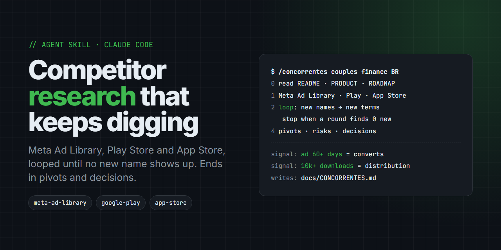

# Competitor Research Skill: self-expanding competitor analysis for Claude Code



**`concorrentes`** is an open-source [Agent Skill](https://agentskills.io) for **Claude Code** that runs a **self-expanding competitor analysis**: it sweeps the **Meta Ad Library** (Facebook and Instagram ads), **Google Play**, the **App Store** and competitor landing pages, finds competitors you didn't know about, and ends with **pivots, positioning and decisions** for your own project.

Run `/concorrentes` and the skill reads your repo first, then loops through searches until a full round finds no new names. It writes the result to `docs/CONCORRENTES.md` and replies in chat with 10 lines at most.

> Competitor analysis · competitive research · competitor discovery · Meta Ad Library · Facebook Ad Library · app store research · Google Play competitor analysis · market validation · product pivot · positioning · go-to-market research

```
/concorrentes                      # infers the niche from the repo
/concorrentes couples finance BR   # niche + country
/concorrentes Pierre, Fikko        # names you already know
```

---

## Why use it

Every competitor analysis I did stopped at the 3 names I already knew. What changes decisions is the 4th, 5th or 12th name: the one in an ad's copy, in a "best apps" article, or in the store's "similar apps" list. This skill forces the search loop until it runs dry.

| Plain prompt | `concorrentes` |
|---|---|
| Lists the competitors you already named | **Expansion loop**: every advertiser, article, feature and adjacency becomes a new search term (3 rounds minimum) |
| Guesses who advertises | Reads the **Meta Ad Library** in the browser: creatives, start date, repeated copy, CTA, domain |
| Generic market overview | Compares every competitor against **what your project already decided** (README, PRODUCT, ROADMAP) |
| Store data from memory | Opens each **Google Play / App Store** listing: downloads, rating, reviews, last update, in-app price |
| Ends with "consider differentiating" | Ends with **pivots, risks and decisions**, each with a trigger to revisit |

## Install

**Skill (recommended), via [skills CLI](https://github.com/vercel-labs/skills)**
```bash
npx skills add WednyFernandes/competitor-research-skill
```

**Manual, as a global command**
```bash
git clone https://github.com/WednyFernandes/competitor-research-skill
cp competitor-research-skill/skills/concorrentes/SKILL.md ~/.claude/commands/concorrentes.md
```

**Manual, as a project skill**
```bash
mkdir -p .claude/skills/concorrentes
cp competitor-research-skill/skills/concorrentes/SKILL.md .claude/skills/concorrentes/
```

**Requires:** Claude Code with the built-in browser (desktop app) or the Claude in Chrome extension, plus `WebSearch` and `WebFetch`.

## Usage

Type `/concorrentes` with an optional argument: a niche, a country, or competitor names you already know. With no argument, the skill infers the niche from the repo. It also triggers when you ask for a competitive analysis, a benchmark, "who else does this", whether a market is worth entering, a pivot, positioning, or before spending on paid media.

## What it does

| Step | What happens |
|---|---|
| 0. Context | Reads `README.md`, `docs/PRODUCT.md`, `ROADMAP.md` and any existing `CONCORRENTES.md`. Sums up the project in 5 lines: what it is, who it's for, how data gets in, price, and what was decided *not* to do |
| 1. Sources | Meta Ad Library via the browser (headless scrapers get a 403), WebSearch, Play Store and App Store listings, WebFetch of each landing page, and the MCP registry or AdWhispr when connected |
| 2. Expansion loop | Names cited in ad copy, "best apps" articles, "similar apps", competitor blogs, features found in 3+ competitors and adjacent products all become new search terms. It stops only when a full round finds nothing new |
| 3. One row per competitor | Name, audience, how data gets in, privacy, price and trial, paid media (creatives, running since), store stats, distribution channel |
| 4. Analysis | What the ads teach, what the stores teach, top 2–3 vs. us, what to copy, where they lose, pivots, risks, decisions with triggers |
| 5. Output | Writes `docs/CONCORRENTES.md` with the new section on top and history preserved below, plus a source list. It doesn't commit unless asked |

### Signals that count

- An ad running **60+ days** is a creative that converts.
- **10k+ downloads** with reviews means real distribution.
- A name cited in a competitor's copy ("vs X") is the next search term.

## Sample output

Excerpt from a real `docs/CONCORRENTES.md` generated for a couples finance app (Brazil, Sep 2026), translated:

> One-line summary: couples + privacy + manual entry **gets paid for** (R$ 14.90–19.90, proven by Duofi, Fikko, Balance). Nobody in Brazil imports bank statements. The winning paid-media pitch became "send it on WhatsApp"; we lose there and won't enter.
>
> | | Couples | Privacy | How data gets in | Price | Paid media | Where |
> |---|---|---|---|---|---|---|
> | **Pierre** | "no fights" creative since Jun 30 | no | Open Finance + WhatsApp | 7-day trial | 30+ creatives since May '26 | Play 4.7 |
> | **Duofi** | "yours, mine and ours" | yes | 100% manual | R$ 14.90 | 1 creative, Sep 11 | PWA |
> | **Balance** | native | partial | manual | 7-day trial | — | Play 50k+, 4.7, 1,320 reviews |

## Project structure

```
skills/concorrentes/SKILL.md   # the skill: context, sources, expansion loop, analysis, output
LICENSE
```

## FAQ

**Why is the command called `/concorrentes`?**
It's Portuguese for "competitors". The skill was written in Portuguese and defaults to Brazil-focused searches (BRL prices, `country=BR` in the Ad Library), but you can pass any niche or country as the argument.

**Why does it need a browser?**
Headless scrapers get a 403 from the Meta Ad Library. The skill opens the Ad Library and the store listings in the built-in browser and reads the page text instead.

**Does it change my repo?**
It writes or updates `docs/CONCORRENTES.md` and nothing else. It doesn't commit without asking.

**How is it different from [what-am-i-missing](https://github.com/WednyFernandes/what-am-i-missing)?**
`what-am-i-missing` checks a plan against laws, standards and frameworks. `concorrentes` looks outward at who is already in the market, what they pay to advertise, and what that means for your positioning.

## License

[MIT](LICENSE) © Wedny Fernandes
